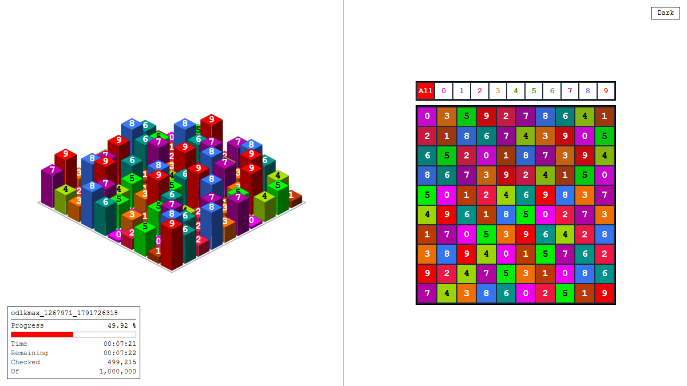

# ODLK1 Voxel

Real-time visualization of an **ODLK** BOINC task (diagonal Latin squares 10×10) as an interactive 3D 10×10×10 voxel cube:
**X** is the column, **Y** is the row, **Z** is the digit in the cell. It displays the current square being tested by ODLK and live workunit statistics.



## Quick start

Requirements: **Windows**, **Python 3.8+**, running ODLK tasks (`odlk3` / `odlkmax` version 1.0) in BOINC. No extra pip packages required.

1. Download `odlk1-voxel.zip` from [Releases](../../releases/latest) and extract it.
2. Run `start_odlk.bat`.
3. The visualizer opens in your browser at `http://127.0.0.1:8080`, and an icon appears in your Windows system tray to pause, resume, or exit.

> If BOINC is installed as a Windows service, run `start_odlk.bat` as administrator so Windows permits reading process memory.

To test without BOINC, launch the demo generator via `start_demo.bat`.

## How it works

```
odlk*.exe --(read-only memory)--> sniffer.py --UDP 127.0.0.1:5005--> bridge.py --> browser
                                                                        |
                                        boinccmd --get_tasks -----------+ (name, time, remaining)
```

- `sniffer.py` reads the running ODLK process memory (`PROCESS_VM_READ`) without any memory writes or injections. It automatically selects the workunit with the lowest progress and follows it to completion before moving to the next.
- `bridge.py` receives UDP frames, queries `boinccmd`, serves static assets from `web/`, and pushes updates to the browser via SSE.
- `web/` is a lightweight Three.js frontend (bundled locally): 3D cube, live 10×10 matrix, workunit statistics, and theme toggle.

Displayed statistics: workunit name (WU), progress bar, elapsed time, estimated remaining time (from BOINC), squares checked, and total search size.

## Memory layout in ODLK

Offsets from the exe base (odlk3 / odlkmax 1.0, windows_x86_64), discovered through reverse-engineering:

| Offset | Type | Description |
|---|---|---|
| `+0x50B040` | `uint8[100]` | current square being tested |
| `+0x50B120` | `uint8[100]` | end square of the search range |
| `+0x50B190` | `uint64` | N - total workunit size (from `input.txt`) |
| `+0x50B198` | `uint64` | checked squares count (`progress = checked / N`) |
| `+0x50B1A0` | `uint64` | generated squares count |

For other ODLK builds, locate the matrix using `python sniffer.py --scan` or `python sniffer.py --auto`.

## Options

```bash
python bridge.py  --http-port 8080 --udp-port 5005
python sniffer.py --process "odlk3*" --pid 1234 --hz 60
python sniffer.py --scan
python mock_sender.py --steps 200
```

`boinccmd.exe` and the BOINC data directory are detected automatically.
For custom installations, use `--boinccmd <path>` and `--boinc-data <path>`.

## Safety

The sniffer opens target processes strictly with read-only access and executes at below-normal priority. This project is independent and not affiliated with ODLK or BOINC.

## License

MIT. Three.js is MIT (see `web/vendor/LICENSE-three.txt`).
